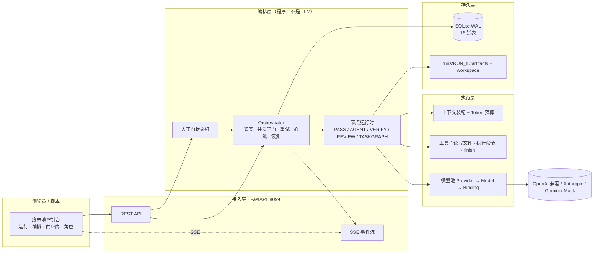

<div align="center">

# AM-Workflow

**让「一句话想法」走完一条可审批、可追溯、可恢复的多智能体研发流水线**

引擎拥有控制流、上下文与状态；模型只是可替换的节点；人工审批是一等公民；完成与否由证据判定。

[](#开发与测试)
[](https://www.python.org/)
[](https://nodejs.org/)
[](LICENSE)
[](#项目状态)
[](#参与贡献)

[项目定位](#项目定位) · [核心特性](#核心特性) · [系统架构](#系统架构) · [快速开始](#快速开始) · [使用指南](#使用指南) · [配置参考](#配置参考) · [HTTP API](#http-api) · [开发与测试](#开发与测试) · [已知限制](#已知限制) · [参与贡献](#参与贡献)

</div>

---

## 项目定位

AM-Workflow 是一个**网页端多智能体软件研发工作流平台**。它把「想法 → 讨论 → 方案 → 需求 → 设计 → 任务 → 并行开发 → 交付」固化成一张可执行的节点图，由服务端的编排器推进状态，在每个关键节点前插入人工门，并把每一步的产出沉淀为带版本与状态的工件链。

它不是「让 AI 一口气写完一个项目」的提示词工程，而是把 LLM 放进一个**受控的状态机**里：能做什么、何时停下、由谁签字、失败如何回退，全部由程序决定。

### 设计原则

| 原则 | 含义 | 代码位置 |
| --- | --- | --- |
| **引擎拥有控制流** | 调度、并发、超时、重试、门禁、恢复都由代码决定，模型不参与流程决策 | [`engine/orchestrator.py`](backend/app/engine/orchestrator.py) |
| **模型只是节点** | 角色 = 提示词 + 工具集 + 步数上限；换模型不改流程 | [`agents/templates/roles.py`](backend/app/agents/templates/roles.py) · [`models/pool.py`](backend/app/models/pool.py) |
| **人工审批是一等公民** | 门挂起不占协程、进程重启后门原样保留、驳回必须带目标节点与反馈 | [`engine/gates.py`](backend/app/engine/gates.py) |
| **完成由证据判定** | 工件结构校验、命令退出码、评审结论；模型调用 `finish` 只是「声明」，不是「完成」 | [`engine/validate.py`](backend/app/engine/validate.py) · [`engine/runners.py`](backend/app/engine/runners.py) |

### 十秒了解

| 你给它 | 它给你 | 谁做决定 |
| --- | --- | --- |
| 一段想法（≤ 20,000 字） | 8 阶段 18 节点的完整工件链 + 可运行工作区 | 引擎调度，人工签 5 道门 |
| 一份 Markdown 设计规格 | 8–40 条可校验任务、波次、关键路径、可拖拽执行图 | PM 只提议，服务端确定性校验 |
| 一套供应商 + API Key | 按角色路由的模型调用、token 预算与成本核算 | 密钥 Fernet 加密落盘 |

---

## 项目状态

| 模块 | 状态 | 说明 |
| --- | --- | --- |
| 后端 API | 稳定 | FastAPI + SQLAlchemy + SQLite（WAL），约 60 个 REST 端点 |
| 编排引擎 | 稳定 | 依赖就绪并发、超时、指数退避、attempt 心跳、取消收据、死锁判定、崩溃恢复 |
| 固定 SDLC 模板 | 稳定 | 8 阶段 / 18 节点 / 5 道人工门 / 8 类工件 |
| 人工门 | 稳定 | 通过 · 驳回（反馈 + 目标节点 + 级联重置）· 编辑后通过 |
| 工件链 | 稳定 | YAML front-matter、版本递增、active/superseded/approved 状态机 |
| 事件流 | 稳定 | SSE + `Last-Event-ID` 补发 + 15s 心跳帧 + 终态主动关闭 |
| 前端控制台 | 稳定 | 运行列表 / 运行详情 / 编排工作台 / 数据统计 / 供应商 / 角色模板（Vite + React 18） |
| 编排工作台 | 可用 | 生成 → 校验 → 编辑 → 画布拖拽 → 提交运行，支持快照回滚与 30 步撤销 |
| 数据统计 | 可用 | 全局运行量 / 成功率 / 耗时 / Token / 成本 / 趋势 / 状态分布（只读聚合，6 个接口） |
| 代码评审 + 验收门 | 实验 | 启发式静态评审（文件摘要 + 验收清单），无 diff / AST / 覆盖率分析 |
| 多进程 / 分布式 | 设计封存 | 见 [`docs/分布式执行模式设计.md`](docs/分布式执行模式设计.md) |
| 单元测试 | 通过 | `93 passed`（pytest，约 3 秒）；前端 `tsc --noEmit` 无错误 |

> W1 的目标是**把控制流跑通并证明它可靠**，不是把生成质量做到可交付。质量与规模的边界见 [已知限制](#已知限制)。

---

## 核心特性

### 1. 可执行的 SDLC 状态机

- **18 个节点、8 个阶段**：想法 → 三方讨论（主张 / 质疑 / 回应 / 主持人蒸馏）→ 方案 → 需求（EARS）→ 设计（编号章节）→ 任务分解 → 并行开发 → 验证 → 交付。
- **节点类型**：`PASS`、`AGENT`、`VERIFY`、`REVIEW`、`TASKGRAPH`（解析 / 展开）、`HUMAN_GATE`，另有 `DECISION` / `RESTORE` / `CHECKPOINT` 预留。
- **动态展开**：任务清单被解析成 `Task` 行后，按依赖生成 `dev_*` 节点，并把 `verify` 的依赖重写为全部开发节点。

### 2. 可靠执行（不依赖模型自觉）

- **并发闸门**：进程级 `asyncio.Semaphore(AM_NODE_CONCURRENCY)`，跨 run 共享；排队节点保持 `pending`，不吃超时预算。
- **超时**：每次 attempt 受 `AM_NODE_TIMEOUT_S` 约束，节点可用 `config.timeout_s` 覆盖。
- **退避重试**：指数退避 + equal jitter（3s 起、60s 封顶），等待期间不占并发槽，并发出 `node_retry_scheduled` 事件。
- **attempt 收据**：每次执行写 `node_attempts`（含心跳、token、错误）；取消时记「未回执」，节点回 `pending`，不留幽灵 `running`。
- **失败升级**：非致命失败自动带反馈重试；达到上限转人工门，人工通过 = 重试该节点，而不是标记完成。
- **崩溃恢复**：启动时 `recover()` 把未回执 attempt 作废、节点回 `pending`，待决门原样保留并重新入队。

### 3. 人工门（Approve / Reject / Edit）

| 动作 | 行为 |
| --- | --- |
| **通过** | 门节点 `done`，关联工件状态置 `approved`；若为失败升级门，则节点回 `pending` 重试 |
| **驳回** | 必填 `feedback` + `target_node`；目标节点与全部下游级联重置，反馈注入下一轮提示词 |
| **编辑后通过** | 审批卡内直接改工件正文 → 写入新版本（`approved`）→ 再通过 |

门挂起时 run 置 `waiting_human`，**不占协程**；进程重启后门与节点状态原样保留。方案确认门会自动列出讨论稿里的「未决项」，需要人拍板的问题不会被模型替你决定。

### 4. 工件链与证据

- 9 类工件定义（W1 产出 8 类）：`idea` / `discussion` / `proposal` / `review` / `requirement` / `design` / `task` / `changelog`（`test` 预留）。
- 落盘 `runs/<run_id>/artifacts/<kind>.vN.md`，并维护 `<kind>.md` 指向当前版本；每次写入自动把旧版本置 `superseded`。
- 每份工件带 YAML front-matter：`id / kind / status / version / inputs / created`。
- **结构校验由程序执行**：需求强制 EARS（`WHEN … THE SYSTEM SHALL …`）≥ 3 条 + Given/When/Then；设计强制 ≥ 3 个编号章节；任务清单强制行内元数据；正文过短直接判失败重试。

### 5. 编排工作台（Design → Plan → Run）

- **提议与判定分离**：PM Agent 只输出候选任务 JSON；uid 唯一性、依赖存在性、成环（返回环路径 `T3→T5→T3`）、章节可追溯、任务数量、验收条数全部由 [`engine/planner.py`](backend/app/engine/planner.py) 确定性校验。
- **确定性编排**：拓扑分层算波次、按 effort 点数（S1 / M2 / L3 / XL5）做最长路算关键路径、汇总并行度与角色分布。
- **四视图工作台**：任务详情（内嵌编辑 + 400ms 防抖重校验）、流程监控（Start → Phase → Verify → End）、活动时间线、可拖拽执行图（存坐标、增删依赖、连线环检测、聚焦链路）。
- **快照与覆盖**：每次校验写 `plan_snapshots`（保留单一 `is_valid`），可按版本恢复；设计覆盖率按 Markdown 章节统计，未覆盖章节以警告返回。
- **两种提交**：`save` 只锁定计划；`run` 生成 `Task` + `dev_*` + `verify` + 可选 `review` + `gate_accept`，随后交给现有编排器执行。

### 6. 代码评审与验收门

- **REVIEW 节点**：读取 idea、任务验收清单、verify 结果与 workspace 摘要（最多 16 个文本文件 / 26,000 字，跳过二进制与构建产物），要求模型只输出严格 JSON。
- **阻塞判定**：`severity ∈ {blocker, major}` 且携带合法 `task_uid` 才算阻塞；编排器回退对应 `dev_*` 与 `verify`、`review`，把问题带进下一轮提示词。
- **轮次控制**：默认最多返工 2 轮，用尽后升级人工门，由人决定驳回或放行。
- **评审面板**：`GET /runs/{id}/review` 返回结论、轮次、阻塞数、问题列表与报告正文；可勾选任务批量返工。

### 7. 模型层：Provider → Model → Binding

- 三层解耦：**Provider**（协议 / URL / 密钥 / 并发）→ **Model**（名称 / 窗口 / 能力 / 价格）→ **Binding**（角色默认模型）。
- 协议适配器：`openai_chat`（完整流式 + 原生工具调用）、`anthropic_messages`、`gemini_generate`（可工作，暂为伪流式）。
- **能力降级**：模型无 `cap_tools` 时自动切换为提示词 JSON 协议（`{"tool": …}` / `{"final": …}`）。
- 内置预设：DeepSeek / OpenAI / GLM / 豆包 / Kimi / 百炼 / SiliconFlow / OpenRouter / Anthropic / Gemini / 自建。
- 密钥 Fernet 加密落盘，接口只回显末四位；支持 `GET /models` 拉取导入与真实对话连通性测试。

### 8. 可观测性

- SSE 事件流：状态迁移先写事件（`events(run_id, seq)` 唯一），再广播；`node_token` 只走内存，不落库。
- `GET /runs/{id}/metrics`：wall time、节点状态计数、attempt 次数 / 重试 / 忙碌时长 / P95、token 用量与估算成本、人工门等待、逐节点明细、评审指标。
- 运行详情页的 STATE 面板直接展示重试、P95 与门等待，用于定位慢节点与卡点。

### 9. 全局数据统计（Analytics）

- **只读聚合**：`/api/analytics/*` 六个接口全部从 `runs` / `nodes` / `node_attempts` / `tasks` / `model_entries` 现算，不新建表、不写任何行、不碰编排逻辑。
- **统一口径**：六个接口共用同一个时间窗解析（`days=7/30/90`，或 `start`/`end` 自定义区间），按 `runs.created_at` 过滤、UTC 自然日切桶；非法参数一律 400，不静默纠正。
- **定义明确**：成功只算 `finished`，失败只算 `failed`（`stopped` 是人工停止，不算失败）；成功率 = 成功 / 总数，总数为 0 时返回 0；平均耗时只统计 `finished` 且 `finished_at` 齐全的运行，无样本返回 `null`（前端显示 `--`）。
- **不编造数据**：成本复用 `metrics` 的同一算法（`price_in` / `price_out` 按每百万 token 折算，只算已归因模型的 attempt）；当前范围内没有已计价模型时 `available=false`，页面显示「暂无成本数据」，绝不用 token 数估一个数。
- **图元零依赖**：趋势柱、状态环形图、占比条都是原生 SVG / CSS（配色取自 `endfield.css` 变量），没有引入任何图表库；点击环形图或图例即按状态筛选最近运行记录。
- **查询数固定**：卡片、趋势、模型分布、最近运行全部用 `group by` 聚合，不做 per-run 查询（无 N+1）。

---

## 系统架构



### 分层说明

| 层 | 职责 | 关键文件 |
| --- | --- | --- |
| 接入层 | REST + SSE + 前端静态托管 + SPA 深链接回退 | [`app/main.py`](backend/app/main.py) · [`app/api/`](backend/app/api) |
| 编排层 | 调度循环、并发闸门、重试与超时、门禁、恢复、指标 | [`engine/orchestrator.py`](backend/app/engine/orchestrator.py) · [`engine/gates.py`](backend/app/engine/gates.py) |
| 执行层 | 节点类型分发、上下文装配、工具执行、工件读写、评审 | [`engine/runners.py`](backend/app/engine/runners.py) · [`engine/context.py`](backend/app/engine/context.py) · [`tools/registry.py`](backend/app/tools/registry.py) |
| 模型层 | 协议适配、并发限流、模型发现与连通性测试、密钥解密 | [`models/pool.py`](backend/app/models/pool.py) · [`models/providers/`](backend/app/models/providers) |
| 持久层 | 16 张表（运行 / 节点 / attempt / 事件 / 工件 / 门 / 任务 / 计划 / 快照 / 记忆 / 供应商 / 模型 / 角色 / 消息 / 工作流） | [`db/models.py`](backend/app/db/models.py) · [`db/base.py`](backend/app/db/base.py) |

### 一次运行的控制流

1. `POST /api/runs` 落库 run + 固化节点（来自 `templates/sdlc_workflow.json`）→ `orchestrator.start()`。
2. 调度循环取「依赖全部 `done`/`skipped` 且无退避等待」的节点，按最小波次成批 `gather` 执行。
3. `AGENT` 节点装配 system / user 提示词（含记忆、工件、反馈、预算），进入「模型 ↔ 工具」循环，直到调用 `finish` 或步数用尽。
4. `VERIFY` 节点在工作区执行命令，只看退出码；`REVIEW` 节点产出结构化 JSON 与 `review` 工件。
5. 命中人工门 → run 置 `waiting_human`，调度协程退出；人通过/驳回后 `kick()` 唤醒。
6. 全部节点 `done` → `run_finished`；存在失败且无可重试路径 → `run_error` 并记录原因。

### 运行时状态

| 对象 | 状态 |
| --- | --- |
| Run | `created` → `running` → `waiting_human` → `finished` / `failed` / `stopped` |
| Node | `pending` / `ready` → `running` → `done` / `failed` / `waiting_human` / `skipped` |
| Gate | `open` → `approved` / `rejected` |
| Artifact | 版本 active → `superseded`；front-matter `draft` / `reviewed` / `approved` |

### 事件类型（SSE）

`run_created` · `run_finished` · `run_error` · `run_stopped` · `run_recovered` · `phase_entered` · `node_started` · `node_finished` · `node_failed` · `node_retry_scheduled` · `node_log` · `node_token`（内存直推）· `node_tool_call` · `node_tool_result` · `node_created` · `task_created` · `task_updated` · `artifact_written` · `gate_requested` · `gate_decided` · `nodes_reset` · `review_blocked` · `review_rework` · `plan_token` · `plan_generated` · `plan_failed`

---

## 技术栈

| 层 | 选型 |
| --- | --- |
| 后端 | Python 3.11+ · FastAPI · Uvicorn · SQLAlchemy 2.x · Pydantic · httpx · cryptography（Fernet） |
| 存储 | SQLite（WAL + `synchronous=NORMAL` + 单连接池 `pool_size=1`） |
| 前端 | Vite · React 18 · TypeScript · Ant Design 5 · TanStack Query · React Router · @xyflow/react · zustand |
| 视觉 | 终末地控制台风格（纸白 / 墨黑 / 单一信号黄），Saira 字体（SIL OFL） |
| 测试 | pytest（后端 · 65 用例）· `tsc --noEmit`（前端类型检查） |

---

## 快速开始

### 环境要求

| 依赖 | 版本 | 说明 |
| --- | --- | --- |
| Python | 3.11+ | 本机验证 3.13 |
| Node.js | 18+ | 本机验证 24，需 npm |
| 操作系统 | Windows / Linux / macOS | 一键脚本为 Windows 专用，其他平台手动启动 |

### 1. 克隆与安装

```powershell
git clone https://github.com/TheBland73/am-workflow.git
cd am-workflow

# 后端
python -m venv .venv
uv pip install --python .\.venv\Scripts\python.exe -r backend\requirements.txt
# 没有 uv 时：
# .\.venv\Scripts\python.exe -m pip install -r backend\requirements.txt

# 前端（构建产物由 FastAPI 直接托管）
cd frontend
npm install
npm run build
```

> 若本机 `pip` 的 resolver 长时间空转，推荐 `uv`；若 npm 跳过了 esbuild 的安装脚本，构建前执行 `npm rebuild esbuild`。

### 2. 一键启动（Windows）

双击根目录的 `start-am-workflow.bat`：脚本会在后台拉起 Mock 供应商（`127.0.0.1:8100`）与应用（`127.0.0.1:8099`），健康检查通过后自动打开浏览器。停止时双击 `stop-am-workflow.bat`。

- 日志：`logs\api.log`、`logs\api.err.log`、`logs\mock.log`
- 已在运行时重复双击只会打开新标签页，不会重复起进程
- 实际逻辑在 [`launcher.ps1`](launcher.ps1) / [`stopper.ps1`](stopper.ps1)，Windows 专用

### 3. 手动启动（跨平台）

两个进程，都在 `backend` 目录下：

```bash
# 终端 1：离线 Mock 模型供应商（OpenAI 兼容，:8100）
../.venv/bin/python -m uvicorn scripts.mock_provider:app --host 127.0.0.1 --port 8100

# 终端 2：AM-Workflow（API + 前端静态站点，:8099）
../.venv/bin/python -m uvicorn app.main:app --host 127.0.0.1 --port 8099
```

浏览器打开 <http://127.0.0.1:8099/>，健康检查：`curl http://127.0.0.1:8099/api/health`。

### 4. 前端开发模式

```bash
cd frontend
npm run dev          # http://127.0.0.1:5173，/api 代理到 8099
```

代理目标可覆盖：`AM_API_TARGET=http://127.0.0.1:8375 npm run dev`（Windows PowerShell 用 `$env:AM_API_TARGET="…"`）。

### 5. 五分钟离线演练

```powershell
cd backend
..\.venv\Scripts\python.exe scripts\e2e_demo.py --auto --demo-reject
```

脚本会创建「Mock 供应商 + mock-fast 模型」→ 建 run → 自动过门；在需求门先驳回一次（要求补一条导出周报），验证退回重做，再依次通过其余门，最后打印工件、任务、节点与 token 用量。

其他脚本：

| 脚本 | 用途 |
| --- | --- |
| `scripts/drive_run.py --latest --demo-reject` | 驱动已有 run 过门 |
| `scripts/smoke_plan.py` | 编排工作台冒烟：建计划 → 生成 → 校验 → 仅保存提交 |
| `scripts/check_sse.py` | 校验 SSE 事件流与补发 |
| `scripts/setup_real_model.py` | 一步完成「建供应商 / 模型 → 绑角色 → 建运行」 |

### 6. 接入真实模型

1. 打开「供应商」页，选择预设（DeepSeek / OpenAI / GLM / 豆包 / Kimi / 百炼 / SiliconFlow / OpenRouter / Anthropic / Gemini / 自建），填 Base URL 与 API Key；
2. 点「拉取模型」从 `GET /models` 导入（已存在的自动跳过），或手填模型名与上下文窗口；
3. 在「角色」页把 `dev` / `review` / `pm` 等角色绑定到该模型；
4. 点「测试」真发一轮对话确认连通（带模型时返回延迟与回复）；
5. 按 [`docs/tasks/real-model-ledger-test.md`](docs/tasks/real-model-ledger-test.md) 跑一遍「随手账本」验收清单。

---

## 使用指南

### 运行页（RUNS）

新建运行：填写想法与 token 预算（默认 1,200,000）→ 应用按固定模板固化 18 个节点并立即开始调度。运行详情页由命令栏、阶段圆盘、执行图、运行账本、内联人工门裁决卡与评审面板组成；工件可在线查看、编辑并保存为新版本。

### 人工门怎么用

- **通过**：确认当前工件，进入下一阶段；
- **驳回**：选择目标节点 + 写清反馈；目标节点及其全部下游会被重置，反馈进入下一轮提示词（这是「返工」而不是「重跑」）；
- **编辑后通过**：直接在卡片里改工件正文，保存即产生新版本并置 `approved`。

### 编排工作台（PLANS）

1. **新建计划**：粘贴 Markdown、上传 `.md`，或从某次运行的 `design` 工件导入；
2. **生成任务**：PM Agent 只提议任务，服务端做结构校验并给出错误码、位置与修复提示；
3. **编辑**：任务详情内嵌表单（400ms 防抖重校验）、画布拖节点存坐标、拖手柄加依赖、点连线删依赖、`Ctrl/Cmd+Z` 撤销（最多 30 步，前端栈）；
4. **校验**：成环、缺依赖、章节不可追溯、任务数越界都会阻断提交；覆盖率不足只警告；
5. **提交**：`仅保存` 锁定计划；`创建运行` 可选预算、代码评审 Agent、验收人工门（后两者默认开）；
6. **复盘**：活动时间线记录创建 / 生成 / 校验 / 提交 / 归档，快照可回滚。

### 断点恢复演练

跑到任意人工门 → 杀掉 API 进程 → 重启 → 刷新页面：门仍在、节点状态不变，继续通过即可跑完。未回执的 attempt 会被标记为失败并回到 `pending`（不带 checkpoint，整节点重跑）。

---

## 配置参考

### 环境变量

| 变量 | 默认值 | 说明 |
| --- | --- | --- |
| `AM_DATABASE_URL` | `sqlite:///data/am.db` | 数据库连接串 |
| `AM_DATA_DIR` | `<repo>/data` | 数据库与密钥目录 |
| `AM_RUNS_DIR` | `<repo>/runs` | 运行产物目录 |
| `AM_SECRET_KEY` | 自动生成 | Fernet 口令；不设则首次启动写入 `data/secret.key` |
| `AM_NODE_CONCURRENCY` | `4` | 同时执行的节点数上限（进程级，跨 run 共享） |
| `AM_NODE_TIMEOUT_S` | `900` | 单次 attempt 超时秒数；`0` = 不限制；节点 `config.timeout_s` 可覆盖 |
| `AM_RETRY_BASE_S` | `3` | 指数退避起始延迟（秒） |
| `AM_RETRY_MAX_S` | `60` | 指数退避延迟上限（秒） |
| `AM_HEARTBEAT_S` | `15` | 执行中 attempt 的心跳间隔（秒） |
| `AM_ATTEMPT_STALE_S` | `120` | attempt 心跳陈旧判定阈值（秒） |
| `AM_RUN_BUDGET_TOKENS` | `1200000` | 新建运行的默认 token 预算 |
| `AM_STREAM_TOKENS` | `1` | 设为 `0` 关闭 token 级流式事件（`node_token`） |
| `AM_MAX_REWORK_ROUNDS` | `3` | 预留；当前返工上限由节点 `max_attempts` / `review.max_rounds` 决定 |
| `AM_MEMORY_EXTRACT` | `1` | 预留；记忆抽取尚未接入执行链路 |
| `AM_CORS_ORIGINS` | `http://127.0.0.1:5173,http://localhost:5173` | 开发模式允许的前端来源 |
| `AM_DEMO_BASE_URL` | `http://127.0.0.1:8100/v1` | 预留；`e2e_demo.py` 当前写死同一地址 |
| `AM_API_TARGET` | `http://127.0.0.1:8099` | Vite 开发代理目标（仅 `npm run dev`） |
| `AM_NO_BROWSER` | 未设置 | 设为 `1` 时一键启动不自动开浏览器 |
| `VITE_API_BASE` | `/api` | 前端构建期 API 前缀 |

### 数据落盘

```
data/            # SQLite（am.db / -wal / -shm）与 secret.key，已 git 忽略
runs/<run_id>/   # artifacts/<kind>.vN.md · workspace/ · 运行产物，已 git 忽略
logs/            # 一键启动的 api/mock 日志与 pids.json
```

### 端口被占用

Windows 的端口排除范围可能占用 8099/8100，检查：

```powershell
netsh int ipv4 show excludedportrange protocol=tcp
```

可改用 8375/8376：启动命令加 `--port 8375` / `--port 8376`，并把供应商 Base URL 与 `AM_API_TARGET` 同步改到对应端口。

### SQLite 约束（重要）

连接池固定 `pool_size=1`、`check_same_thread=False`、`busy_timeout=5000`、WAL + `synchronous=NORMAL`。因此：

- **禁止在 `session_scope()` 事务内再开 session 或 `await`**（会自锁或长占唯一连接）；
- SSE 生成器绝不持有 session；`node_token` 不落库；
- 多写场景请走编排器串行入口，不要在并发协程里各开事务。

---

## HTTP API

统一前缀 `/api`，OpenAPI 文档见 `http://127.0.0.1:8099/docs`。

| 分组 | 端点 |
| --- | --- |
| 供应商 | `GET /presets` · `GET/POST /providers` · `PATCH/DELETE /providers/{id}` · `GET /providers/{id}/models` · `POST /providers/{id}/models/import` · `POST /providers/{id}/test` |
| 模型 | `GET/POST /models` · `PATCH/DELETE /models/{id}` |
| 角色模板 | `GET /agent-templates` · `PATCH /agent-templates/{id}` |
| 运行 | `POST/GET /runs` · `GET /runs/{id}` · `POST /runs/{id}/stop` · `GET /runs/{id}/metrics` · `GET /runs/{id}/review` · `POST /runs/{id}/review/rework` |
| 事件 | `GET /runs/{id}/events`（SSE）· `GET /runs/{id}/events/history` · `GET /events/{id}` |
| 工件 | `GET /runs/{id}/artifacts` · `GET/PATCH /runs/{id}/artifacts/{kind}` |
| 人工门 | `GET /gates` · `GET /gates/{id}` · `POST /gates/{id}/approve` · `POST /gates/{id}/reject` |
| 任务 / 节点 | `GET/POST /runs/{id}/tasks` · `PATCH/DELETE /runs/{id}/tasks/{uid}` · `GET /nodes/{id}` · `POST /nodes/{id}/retry` |
| 记忆 | `GET /memories` · `PATCH /memories/{id}` |
| 统计 | `GET /analytics/overview` · `GET /analytics/trends` · `GET /analytics/status-distribution` · `GET /analytics/usage` · `GET /analytics/recent-runs` · `GET /analytics/failed-runs`（均支持 `days=7/30/90` 或 `start`/`end`） |
| 编排 | `POST/GET /plans` · `GET /plans/{id}` · `GET /plans/{id}/phases` · `GET /plans/{id}/activity` · `POST /plans/{id}/generate` · `GET /plans/{id}/events`（SSE）· `POST /plans/{id}/validate` · `POST /plans/{id}/commit` · `POST /plans/{id}/cancel` · `POST /plans/{id}/archive` · `PATCH /plans/{id}/layout` · `POST/DELETE /plans/{id}/deps` · `GET /plans/{id}/snapshots` · `POST /plans/{id}/restore/{version}` · `POST /plans/{id}/tasks` · `PATCH/DELETE /plans/{id}/tasks/{uid}` |

SSE 约定：响应带 `id: <seq>` 与 `event: <type>`；断线重连带 `Last-Event-ID` 先补发历史再订阅实时队列；服务端每 15s 发注释帧保活，终态事件后主动关闭。

---

## 项目结构

```text
am-workflow/
├── backend/
│   ├── app/
│   │   ├── main.py                  FastAPI 入口、lifespan（建表 → 种子 → 恢复）、静态托管
│   │   ├── config.py                路径、并发、超时、退避、预算等配置
│   │   ├── db/                      engine/session（SQLite WAL + 单连接池）与 16 张 ORM 表
│   │   ├── api/                     providers · models · agent-templates · runs · artifacts ·
│   │   │                            gates · tasks · nodes · memories · plans · analytics
│   │   ├── engine/
│   │   │   ├── orchestrator.py      调度循环、并发闸门、超时、退避、心跳、门禁、恢复
│   │   │   ├── runners.py           节点执行器（PASS / AGENT / VERIFY / REVIEW / TASKGRAPH）
│   │   │   ├── gates.py             人工门状态迁移与下游级联重置
│   │   │   ├── templates.py         模板装载、内置角色指纹同步
│   │   │   ├── tasks.py             任务清单行格式解析与校验
│   │   │   ├── planner.py           计划校验、波次、关键路径、覆盖率、快照
│   │   │   ├── plan_generation.py   PM 生成、JSON 修复、SSE 推送
│   │   │   ├── events.py            事件总线（seq 缓存 + SSE 格式）
│   │   │   ├── agent_loop.py        模型 ↔ 工具循环、JSON 协议降级
│   │   │   ├── context.py           提示词装配、平台规则、输出约束
│   │   │   └── validate.py          工件结构校验（证据判定的第一道闸）
│   │   ├── models/                  类型、加密、预算估算、Provider 适配器与模型池
│   │   ├── tools/registry.py        文件读写、命令执行、finish（含工作区路径约束）
│   │   ├── artifacts/store.py       工件版本、front-matter、落盘
│   │   ├── memory/store.py          L0/L1/L2 记忆（scope 过滤，无向量）
│   │   └── agents/templates/roles.py 11 个内置角色提示词与工具集
│   ├── scripts/                     mock_provider · e2e_demo · drive_run · check_sse ·
│   │                                smoke_plan · setup_real_model
│   └── tests/                       core · gates · api · planner · plans_api · durability ·
│                                    model_discovery · review · discussion · seed_templates ·
│                                    analytics
├── frontend/                        Vite + React 18 + TS + AntD 5 + @xyflow/react + zustand
│   └── src/{pages,panels,canvas,api,store,styles}
├── templates/sdlc_workflow.json     固定 SDLC 模板（8 阶段 18 节点 5 门）
├── docs/                            设计规格、选型调研、评审体系、迭代记录、测试案例
├── data/                            SQLite 与密钥（git 忽略）
├── runs/                            运行产物与工作区（git 忽略）
└── launcher.ps1 / stopper.ps1       一键启动 / 停止（Windows）
```

---

## 开发与测试

### 后端测试

```powershell
cd backend
..\.venv\Scripts\python.exe -m pytest tests -q
# 93 passed in ~3s
```

覆盖范围：图与任务解析、front-matter、预算估算、门禁通过 / 驳回 / 升级重试、供应商与模型 CRUD、模板绑定校验、计划章节索引 / 错误码 / 波次 / 关键路径 / 环路径、计划 API（生成 / 编辑 / save 与 run 提交 / 幂等 / 归档）、并发闸门 / 节点超时 / 退避重试 / seq 缓存 / 取消收据 / metrics、模型发现与导入去重、评审节点 / 阻塞回退 / 轮次用尽 / 评审 API 与指标、三方讨论、数据统计（空窗口不除零 / 成功率 / 失败计数 / 平均耗时 / Token / 成本空态 / 时间筛选 / 趋势补零 / 状态分布 / 非法参数 400）。

### 前端检查

```bash
cd frontend
npm run typecheck    # tsc --noEmit
npm run build        # 产物 dist/，由 FastAPI 托管
```

### 开发约定

- 单连接池是硬约束：`session_scope()` 内不做网络 IO、不 `await`、不再开 session；
- 状态迁移先写事件再改状态，事件 seq 单调；
- 任何「完成」都必须能追溯到证据（退出码 / schema / 工件状态），不接受模型自述；
- 新功能先补测试，再改实现；提交前跑 `pytest` 与 `typecheck`。

---

## 设计文档

| 文档 | 内容 |
| --- | --- |
| [`docs/设计规格说明书.md`](docs/设计规格说明书.md) | 设计基线 v0.2：领域模型、节点模型、状态机、门、工件、事件、恢复 |
| [`docs/research/前沿技术调研与技术选型.md`](docs/research/前沿技术调研与技术选型.md) | 选型论据（工作流引擎、Agent 编排、可观测性对标） |
| [`docs/评审与测试体系设计.md`](docs/评审与测试体系设计.md) | 三级评审 + 四级测试 + 缺陷闭环 + 质量钩子 + 调度拆屏障 |
| [`docs/评审与验收门.md`](docs/评审与验收门.md) | 代码评审 Agent、阻塞自动回退、验收门、评审面板与指标 |
| [`docs/模型接入配置设计.md`](docs/模型接入配置设计.md) | Provider / Model / Binding 与上下文预算 |
| [`docs/迭代优化-可靠执行.md`](docs/迭代优化-可靠执行.md) | 并发闸门 / 超时 / 退避 / 心跳 / 指标（对标 Temporal、Airflow、Prefect） |
| [`docs/迭代优化-可交互编排画布.md`](docs/迭代优化-可交互编排画布.md) | React Flow 画布、坐标与依赖落库、设计覆盖率 |
| [`docs/编排工作台-迭代记录.md`](docs/编排工作台-迭代记录.md) | R1–R6 体验迭代记录 |
| [`docs/设计规格到任务编排与可视化.md`](docs/设计规格到任务编排与可视化.md) | 设计规格 → 任务图 → 可视化的链路设计 |
| [`docs/分布式执行模式设计.md`](docs/分布式执行模式设计.md) | 多 PC 协作模式（封存，仅设计） |
| [`docs/tasks/`](docs/tasks) | 需求规格与测试案例（随手账本、编排工作台、真实模型验收） |

---

## 已知限制

工程取舍写在明面上，避免误用：

### 架构与规模

- **单进程语义**：并发闸门、seq 缓存、attempt 心跳都在进程内，未做跨进程租约/仲裁；**不要用 `uvicorn --workers N` 跑多个 worker**。多实例需要外部锁或 DB 租约（M2）。
- **SQLite 单连接池**：所有 API 与引擎共享一条连接，读多写多时会排队；`session_scope()` 内 `await` 会直接卡死。
- **无 TaskGraph 独立校验节点**：任务唯一性与依赖合法性在解析时校验，未提供单独的 `TASKGRAPH validate` 节点。
- **`GET /runs/{id}/metrics` 是即时聚合**：每次全表扫描该 run 的 attempt / 门 / 事件，未落库、无历史趋势。

### 执行与质量

- **空工作区起步**：每个 run 的 `runs/<id>/workspace` 由空目录创建，没有 git 克隆、分支、worktree、合并节点，无法直接维护已有代码库。
- **并行任务共享同一 workspace**：多 agent 同时改同一文件会「后写覆盖先写」，当前需人工按文件拆任务；worktree 隔离与合并节点在 M2。
- **波次批内屏障**：当前按最小波次成批 `gather`，下游要等同批最慢节点结束才进 ready；M1 改为「依赖就绪即跑、单节点完成即唤醒」的事件驱动解锁。
- **证据门可能自证**：`dev` agent 自己写实现、自己写单测，`verify` 只看 `python -m unittest discover` 的退出码；缺少从需求独立派生的测试与覆盖率分析。
- **验证命令固定为 Python**：模板与计划提交都把 `verify.command` 写死为 `python -m unittest discover`，JS / Go / Java 项目无法通过验收。
- **评审是启发式静态评审**：只把 workspace 文本摘要（≤16 文件 / 26,000 字）交给模型，没有 diff、AST 或覆盖率；阻塞项必须带 `task_uid` 才会触发回退，模型漏标即放行。
- **计划任务角色共用 dev 执行器**：`role_key` 目前只追加一句交付偏好，提示词模板与工具集仍是 `dev`。
- **无 attempt 级 checkpoint**：重试是整节点重来，会重复消耗 token；`node_attempts.model_id` 当前未写入，无法按模型归因成本。

### 能力缺口

- Anthropic / Gemini 适配器暂为伪流式；无 MCP 工具接入、无容器化执行、无向量检索与记忆面板、无多 run 调度看板、无执行看板。
- 无 Alembic：schema 演进只支持「加列」（启动时幂等补齐），改列 / 删除列需手写迁移。
- 无 CI 流水线：测试与类型检查需本地执行（`.github` 目前只有 CODEOWNERS）。
- 前端单包约 2.1 MB，未做路由级代码分割；画布未适配触屏；`Ctrl+Z` 是前端撤销栈（刷新即丢，计划提交后锁定）。
- 1440 宽度下工作台为「阶段导航 + 内容」两栏；执行图默认 0.62 缩放，波次多时需横向滚动或点「全览」。

---

## 路线图

| 里程碑 | 目标 | 关键事项 |
| --- | --- | --- |
| **M1** | 把「能跑通」变成「跑得稳」 | 事件驱动解锁替代波次屏障；Anthropic / Gemini 真流式与工具调用；记忆抽取接入；attempt 级模型归因与成本报表 |
| **M1.5** | 让证据更硬 | 由 `test` 角色从需求独立派生验收测试；`verify` 支持覆盖率与自定义命令；评审接入真实 diff |
| **M2** | 走向真实工程 | worktree / 临时目录级隔离 + 合并节点；多 worker 租约与外部锁；容器化执行；MCP 工具接入 |
| **M3** | 走向团队 | 认证与多租户、审计日志、执行看板与多 run 调度、向量记忆与记忆面板 |

---

## 安全模型

> **本项目的默认形态是「本机单人工具」，不是多用户服务。**

- 服务默认只监听 `127.0.0.1:8099`；**没有任何认证、授权、CSRF 防护、速率限制或请求体大小限制**，不要把端口暴露到公网或共享网络。
- `run_command` 工具会在工作区以 `create_subprocess_shell` 执行模型给出的任意命令（`read_file` / `write_file` / `list_files` 有工作区路径约束，但 shell 不受此约束）。因此**只应接入可信的模型与可信的输入文本**，并假设工作区内的文件可能被执行。
- API Key 使用 Fernet 加密落盘（`data/secret.key` 或 `AM_SECRET_KEY`），接口只回显末四位；仍建议使用最小权限、可随时吊销的密钥。
- 若要对外部署，至少补齐：身份认证、按租户隔离数据目录、命令白名单或容器沙箱、审计日志、出站网络策略。

---

## 常见问题

**Q：启动后打开页面一片空白？**
先看 `logs/api.err.log`；确认 `frontend/dist` 已构建（`npm run build`），且 8099 未被端口排除范围占用。

**Q：运行一创建就失败，提示「尚未配置可用模型」？**
到「供应商」页添加供应商并至少启用一个模型；可用 `scripts/setup_real_model.py` 一步完成，或先启动 Mock 供应商做离线演练。

**Q：verify 一直失败？**
`verify` 在 `runs/<run_id>/workspace` 执行 `python -m unittest discover -s . -p "test_*.py"`；确认 dev agent 确实写了 `test_*.py`，并检查节点日志里的 `[exit code: N]` 与输出尾部。

**Q：驳回后为什么整个下游都重跑了？**
这是设计行为：驳回会把目标节点及其全部下游重置为 `pending`，以保证工件链一致。只想回退个别任务时，用运行页评审面板的「回退选中任务」。

**Q：能改成自己的流程吗？**
当前工作流图来自 `templates/sdlc_workflow.json`（`WORKFLOW_FILES` 仅映射 `sdlc_v1`），前端不提供模板上传或节点编辑器；如需自定义，请直接改模板 JSON 并重启（注意 `seed_defaults` 的内置角色指纹同步逻辑）。

---

## 参与贡献

1. **分支**：`feat/<scope>`、`fix/<scope>`、`docs/<scope>`；
2. **提交**：遵循 Conventional Commits（`feat:` / `fix:` / `docs:` / `refactor:` / `test:`），中文描述可直接使用；
3. **提交前自检**：

   ```powershell
   cd backend; ..\.venv\Scripts\python.exe -m pytest tests -q
   cd ..\frontend; npm run typecheck
   ```

4. **PR 要求**：说明动机与改动范围、附复现或验证方式、涉及 UI 的附截图、涉及行为变更的同步更新 README 与 `docs/`；
5. **不要提交**：`data/`、`runs/`、`logs/`、`frontend/dist/`、`.venv/`、`node_modules/`（已在 `.gitignore` 中）。

---

## 许可证与致谢

- 本项目使用 [MIT License](LICENSE) 发布，Copyright (c) 2026 Zerui Li。
- 视觉与交互资产来自 [`hhikr/endfield-ui-skill`](https://github.com/hhikr/endfield-ui-skill)（`endfield.css`、`dial.js`、等距线稿）。
- 字体 Saira 以 SIL Open Font License 随仓库分发（`frontend/src/styles/fonts/Saira-OFL.txt`）。
- 设计对标：Temporal / Airflow / Prefect 的可靠执行模型，LangGraph 的图式编排思路，以及 EARS 需求写法。

<div align="center">

**[⬆ 回到顶部](#am-workflow)**

用可控的流程，换可预期的交付。

</div>
